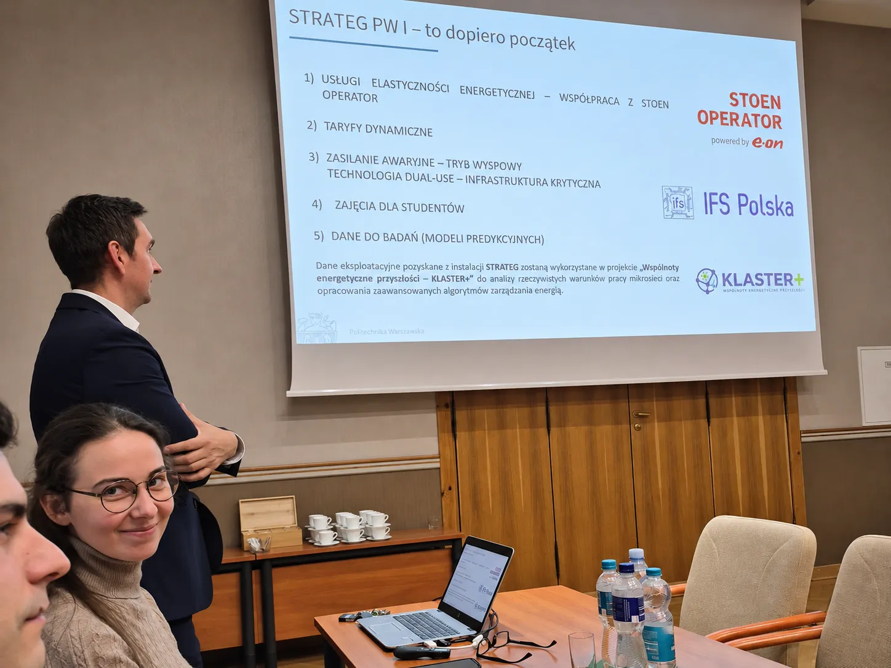

On **3 November 2026**, the Steering Committee of the **Excellence Initiative – Research University (IDUB)** programme at **Warsaw University of Technology (WUT)** met in the University's Senate Hall to review progress on the **STRATEG PW I and II** projects.

> **Related Materials** 
>
> 👉 <i class="fa-solid fa-newspaper"></i> KLASTER+ team visit to the Faculty of Materials Science and Engineering at WUT: [**read the post**](/posts/wim-pw/).
>
> 👉 <i class="fa-solid fa-newspaper"></i> Article on the WIM PW microgrid (G. Komorowska, K. Kalinowski): [**download PDF (in Polish)**]({{ '/assets/posts/2026-11-03-strateg-pw-wim-klaster-plus/pe-instalacja-fotowoltaiczna-magazyn-energi.pdf' | relative_url }}).
{: .prompt-tip }

### Meeting Participants

The meeting was attended by **Prof. Krzysztof Zaremba**, Rector of Warsaw University of Technology, and the Vice-Rectors: **Prof. Mirosław Karpierz, Prof. Mariusz Malinowski, Prof. Jan Słyk, Prof. Adam Woźniak and Prof. Robert Zalewski**.

Other participants included **Prof. Tomasz Wejrzanowski, Aldona Zalewska, DSc, Prof. Radosław Achramowicz, Gabriela Komorowska, MSc Eng., Krzysztof Kalinowski, MSc Eng., and Tadeusz Daszczyński, PhD Eng.**, as well as a representative of **Stoen Operator**.

### Presentation of the WIM PW Project

During the meeting, **Prof. Tomasz Wejrzanowski**, Vice-Dean for General Affairs and Research at WUT's **Faculty of Materials Science and Engineering (WIM)**, presented the results of the project **“Pilot Installation for Energy Generation and Storage Based on Efficient and Durable Photovoltaic and Battery Technologies”**.

The project aims to reduce the electricity drawn from the distribution grid by Warsaw University of Technology buildings through the use of renewable energy sources and energy storage technologies. It has involved both infrastructure development and research activities centred on a pilot installation at WIM.

*Presentation of the STRATEG PW project results at the IDUB Steering Committee meeting, 3 November 2026. From left: **Krzysztof Kalinowski, MSc Eng.**, **Gabriela Komorowska, MSc Eng.**, and **Prof. Tomasz Wejrzanowski**.*

**Tadeusz Daszczyński**, KLASTER+ Project Manager, also contributed to the construction phase as the **investor's supervision inspector for electrical works**. He combines research and teaching at WUT's Faculty of Electrical Engineering with professional engineering practice, holding **unrestricted Polish building licence for electrical design and construction** (licence no. LOD/2597/PWOE/15).

The project was presented by **Prof. Tomasz Wejrzanowski**, **Gabriela Komorowska, MSc Eng.**, and **Krzysztof Kalinowski, MSc Eng.** (pictured above).

The presentation outlined several potential applications of the STRATEG PW installation, including **energy flexibility services in cooperation with Stoen Operator**, **dynamic electricity tariffs**, **emergency power supply in islanded mode**, and the use of operational data to develop **predictive models**.

It also highlighted how the results of STRATEG PW will contribute directly to **KLASTER+**:

> Operational data collected from the STRATEG installation will be used in the “Energy Communities of the Future – KLASTER+” project to analyse actual microgrid operating conditions and develop advanced energy management algorithms.

The WIM PW microgrid is described in an article by **Krzysztof Kalinowski** and **Gabriela Komorowska**: [article in *Przegląd Elektrotechniczny* (in Polish)]({{ '/assets/posts/2026-11-03-strateg-pw-wim-klaster-plus/pe-instalacja-fotowoltaiczna-magazyn-energi.pdf' | relative_url }}).

### Using STRATEG Data in the KLASTER+ Project

The KLASTER+ team plans to use data on **electricity generation and consumption**, together with measurements of **power, voltage and current**. These data will support the development of simulation models in **DIgSILENT PowerFactory** and the analysis of real-world microgrid operating conditions. Another research direction is the use of **field controllers as edge computers** for energy monitoring and management.

In July 2026, members of the KLASTER+ team [visited the Faculty of Materials Science and Engineering at WUT](/posts/wim-pw/) to learn about its photovoltaic installation, battery energy storage system and the potential to use its infrastructure and measurement data in future research. The STRATEG PW presentation outlined concrete opportunities to build on that earlier visit.

> <i class="fa-solid fa-envelope"></i> Newsletter: [**subscribe here**](https://en.klaster-plus.edu.pl/newsletter/) – we only send updates about new posts.
{: .prompt-info }
